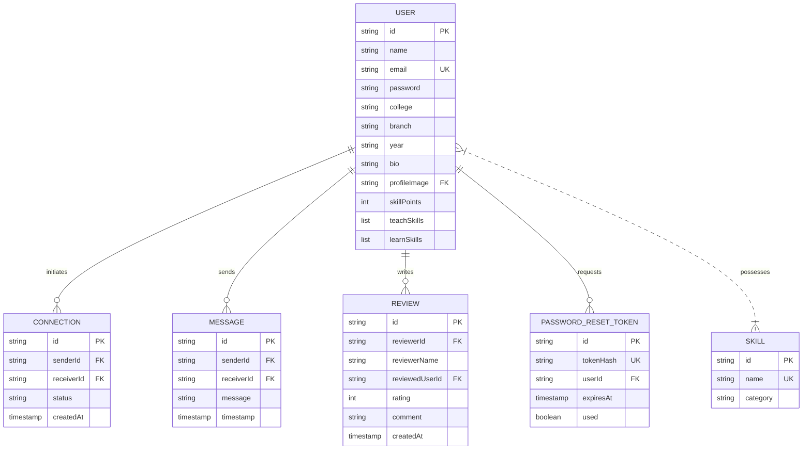

# Skill-Verse — Comprehensive Project Documentation

> **A Peer-to-Peer Student Skill Exchange Platform**  
> Connect. Learn. Teach. Level Up Together.

---

# Table of Contents

- [PART 1: NON-TECHNICAL OVERVIEW](#part-1-non-technical-overview)
  - [1. Executive Summary](#1-executive-summary)
  - [2. The Real-World Problem](#2-the-real-world-problem)
  - [3. The Skill-Verse Solution](#3-the-skill-verse-solution)
  - [4. How It Works (The User Journey)](#4-how-it-works-the-user-journey)
  - [5. Core Platform Features in Everyday Terms](#5-core-platform-features-in-everyday-terms)
  - [6. Real-World Use Cases & Scenarios](#6-real-world-use-cases--scenarios)
- [PART 2: TECHNICAL DEEP-DIVE & ARCHITECTURE](#part-2-technical-deep-dive--architecture)
  - [7. System Architecture & High-Level Design](#7-system-architecture--high-level-design)
  - [8. Tech Stack & Engineering Rationale](#8-tech-stack--engineering-rationale)
  - [9. Frontend Architecture (React 19 & TanStack Start)](#9-frontend-architecture-react-19--tanstack-start)
  - [10. Backend Architecture (Spring Boot 3 & Security 6)](#10-backend-architecture-spring-boot-3--security-6)
  - [11. The Complementary Matching Algorithm](#11-the-complementary-matching-algorithm)
  - [12. Gamification & Reputation Engine](#12-gamification--reputation-engine)
  - [13. Database Schema & Storage (MongoDB & GridFS)](#13-database-schema--storage-mongodb--gridfs)
  - [14. Security & Cryptographic Implementations](#14-security--cryptographic-implementations)
  - [15. Complete REST API Specification](#15-complete-rest-api-specification)
  - [16. DevOps, Docker & Deployment](#16-devops-docker--deployment)
  - [17. Step-by-Step Setup & Running Guide](#17-step-by-step-setup--running-guide)
  - [18. Seeded Demo Accounts](#18-seeded-demo-accounts)
  - [19. Quality Assurance & Testing Suite](#19-quality-assurance--testing-suite)
  - [20. Troubleshooting & FAQ](#20-troubleshooting--faq)

---

# PART 1: NON-TECHNICAL OVERVIEW

## 1. Executive Summary

**Skill-Verse** is a modern, student-centric web platform built on the concept of a **knowledge barter economy**. Instead of paying for expensive tutoring or navigating impersonal online courses, college students use Skill-Verse to trade skills directly with peers.

If Student A knows **Java & Spring Boot** and wants to learn **React**, while Student B excels at **React & UI Design** and wants to master **Java**, Skill-Verse identifies the mutual synergy, scores their match, and facilitates a direct peer-to-peer connection.

The platform combines **intelligent matchmaking**, **gamified reputation systems (skill points & badges)**, **direct messaging**, and **peer reviews** to create a safe, engaging, and collaborative campus learning ecosystem.

---

## 2. The Real-World Problem

College students today face significant learning barriers:
1. **High Cost of Learning:** Private tutors, paid bootcamps, and specialized certifications cost hundreds or thousands of dollars.
2. **Impersonal Courses:** Pre-recorded online videos have a completion rate below 10% because they lack human accountability, interaction, and context-specific troubleshooting.
3. **Siloed Campus Knowledge:** Students within the same university—or across different engineering branches—rarely know what skills their peers possess. A computer science junior might need help with UI design, unaware that a design student in the adjacent department is looking for someone to help them learn Python.
4. **No Structured Exchange Model:** Informal skill swaps usually fall apart because there is no mechanism to track commitment, verify mentor credibility, or safely connect.

---

## 3. The Skill-Verse Solution

Skill-Verse solves this through four pillars:
- **Skill Barter Engine:** Removes financial transactions entirely. Value is exchanged through time, mentorship, and knowledge.
- **Smart Compatibility Matching:** Instead of endless manual scrolling, an automated matching engine scans student profiles and presents ranked recommendations showing exactly why two students are compatible.
- **Trust & Reputation (Gamification):** Every accepted connection and positive peer review earns skill points, unlocking recognized badges (*Helpful Mentor*, *Active Learner*, *Great Collaborator*) that display on the student's public profile.
- **Unified Workspace:** Students can search peers, request connections, chat in real-time, upload profile photos, and review each other after learning sessions—all inside one unified interface.

---

## 4. How It Works (The User Journey)

```text
  ┌──────────────────────────────────────────────────────────────┐
  │ 1. SIGN UP & PROFILE SETUP                                   │
  │    Student registers, selects university/branch, and lists   │
  │    "Skills I Can Teach" & "Skills I Want to Learn".          │
  └──────────────────────────────┬───────────────────────────────┘
                                 │
                                 ▼
  ┌──────────────────────────────────────────────────────────────┐
  │ 2. MATCH DISCOVERY                                           │
  │    Dashboard immediately shows ranked matches with a % score │
  │    (e.g., 94% Match: You teach Java; they teach React).      │
  └──────────────────────────────┬───────────────────────────────┘
                                 │
                                 ▼
  ┌──────────────────────────────────────────────────────────────┐
  │ 3. CONNECT & CHAT                                            │
  │    Send connection requests. Once accepted, both students    │
  │    earn +10 Skill Points and unlock the peer chat.           │
  └──────────────────────────────┬───────────────────────────────┘
                                 │
                                 ▼
  ┌──────────────────────────────────────────────────────────────┐
  │ 4. LEARN, REVIEW & LEVEL UP                                  │
  │    After exchange sessions, leave 1-5 star ratings & reviews. │
  │    Earn skill points, climb the leaderboard, unlock badges!  │
  └──────────────────────────────────────────────────────────────┘
```

---

## 5. Core Platform Features in Everyday Terms

### 🔍 Smart Student Finder
- Search by name, college, department, or technical skill.
- Clear badges highlight whether a skill is something the peer **teaches** or **wants to learn**.

### 🤝 Connection Management
- Three-state connection system: **Pending**, **Accepted**, and **Rejected**.
- Prevents spam: users can only chat once a mutual connection is accepted.

### 💬 Direct Peer Messaging
- Built-in, clean messaging interface to coordinate meeting times, share code snippets, or schedule study calls.

### 🏆 Gamification & Leaderboard
- Students start with 0 points.
- Connecting with peers awards **+10 points**.
- Receiving a 5-star review awards **+25 points** (5 points per star).
- Profile badges automatically highlight verified mentors and active collaborators.

### 📷 Profile Customization & Media
- Upload custom avatars (stored securely with fast image streaming).
- Edit academic branch, graduation year, bio, and add/remove skills on the fly.

### 🔒 Secure Password Recovery
- Forget your password? Enter your email to receive a secure, 1-hour single-use reset link.

---

## 6. Real-World Use Cases & Scenarios

### Scenario A: The Ideal Two-Way Swap (High Compatibility)
- **Krish (3rd Year CS):** Teaches *Java, C++, Spring Boot*; Wants to learn *React, Tailwind CSS*.
- **Aman (2nd Year IT):** Teaches *React, JavaScript, Tailwind*; Wants to learn *Java, Spring Boot*.
- **Outcome:** The algorithm detects a **Two-Way Mutual Exchange** and scores this match at **95%+**. They connect, set up weekly Zoom sessions, and swap backend and frontend expertise.

### Scenario B: Senior Mentor to Junior Explorer
- **Sneha (Final Year):** Expert in *Machine Learning & Python*.
- **Rohan (1st Year):** Eager to learn *Python basics*.
- **Outcome:** Rohan requests a connection. Sneha accepts. Rohan gets personalized mentoring, avoiding generic tutorial pitfalls. Rohan leaves Sneha a 5-star review, awarding Sneha +25 Skill Points and contributing to her *Helpful Mentor* badge.

---

# PART 2: TECHNICAL DEEP-DIVE & ARCHITECTURE

## 7. System Architecture & High-Level Design

Skill-Verse adopts a decoupled **Client-Server Architecture**:

```text
┌─────────────────────────────────────────────────────────────────────────┐
│                              CLIENT TIER                                │
│  React 19 • TanStack Start (SSR / Nitro) • TypeScript 5.8 • Tailwind v4 │
└────────────────────────────────────┬────────────────────────────────────┘
                                     │
                                     │ HTTPS / JSON REST API
                                     │ Bearer JWT Authentication
                                     ▼
┌─────────────────────────────────────────────────────────────────────────┐
│                             API GATEWAY                                 │
│  Spring Security 6 • JwtAuthFilter • CORS Origin Whitelist Filter       │
└────────────────────────────────────┬────────────────────────────────────┘
                                     │
        ┌────────────────────────────┼────────────────────────────┐
        ▼                            ▼                            ▼
┌──────────────────┐       ┌──────────────────┐       ┌──────────────────┐
│   Auth & User    │       │ Match & Ranking  │       │  Social & Chat   │
│    Services      │       │      Engine      │       │     Services     │
└────────┬─────────┘       └─────────┬────────┘       └─────────┬────────┘
         │                           │                          │
         └───────────────────────────┼──────────────────────────┘
                                     │
                                     ▼
┌─────────────────────────────────────────────────────────────────────────┐
│                             DATA ACCESS                                 │
│  Spring Data MongoDB Repositories • MongoTemplate • GridFSBucket        │
└────────────────────────────────────┬────────────────────────────────────┘
                                     │
                                     ▼
┌─────────────────────────────────────────────────────────────────────────┐
│                           PERSISTENCE TIER                              │
│  MongoDB Atlas Cluster: Collections + BSON Document Model + GridFS Chunks│
└─────────────────────────────────────────────────────────────────────────┘
```

---

## 8. Tech Stack & Engineering Rationale

| Layer | Technology | Version | Engineering Rationale |
| :--- | :--- | :--- | :--- |
| **Backend Runtime** | Java OpenJDK | 17 / 21 LTS | High concurrency, robust memory management, enterprise standard. |
| **Framework** | Spring Boot | 3.3.4 | Battle-tested REST framework, dependency injection, declarative security. |
| **Security** | Spring Security | 6.x | Stateless JWT filter chain, BCrypt password hashing, role-free bearer auth. |
| **Token Auth** | JJWT (`io.jsonwebtoken`) | 0.12.6 | Cryptographic HMAC-SHA512 token signing with 24-hour expiration window. |
| **Database** | MongoDB Atlas | 7.x / Cloud | Flexible document model for polymorphic student skills, reviews, and messages. |
| **Media Storage** | MongoDB GridFS | Built-in | Native binary chunking for profile photos up to 5MB without external S3 costs. |
| **Frontend Core** | React | 19.x | Concurrent rendering, latest hooks, optimal reconciliation performance. |
| **Routing / SSR** | TanStack Start + Nitro | 1.168 | Type-safe file routing, server-side pre-rendering, minimal hydration delay. |
| **State Fetching** | TanStack Query | 5.x | Automated background refetching, client cache invalidation, loading states. |
| **Styling** | Tailwind CSS | 4.x | High-performance CSS engine with zero runtime overhead and modern utility tokens. |
| **UI Components** | Radix UI | 1.x / 2.x | Fully accessible, keyboard-navigable headless primitives (Dialogs, Tabs, etc.). |

---

## 9. Frontend Architecture (React 19 & TanStack Start)

### File-Based Routing Hierarchy (`src/routes/`)
- `__root.tsx`: Universal shell wrapper containing global layout, toaster notifications, and authentication provider.
- `index.tsx`: Landing page explaining platform value for unauthenticated visitors.
- `login.tsx` & `register.tsx`: Authentication flows with client-side form validation.
- `dashboard.tsx`: Authenticated dashboard presenting personal stats, active connections, and top recommended matches.
- `find-students.tsx`: Interactive student catalog with real-time text and category filtering.
- `students.$studentId.tsx`: Detailed public profile view of any peer, showing teach/learn tags and star reviews.
- `connections.tsx`: Tabbed management for incoming and outgoing connection requests.
- `messages.tsx`: Real-time chat interface with automatic peer thread selection.
- `skill-points.tsx`: Gamification page detailing point breakdowns, milestone history, and badges.
- `profile.index.tsx` & `profile.edit.tsx`: Self-profile management and GridFS photo uploader.
- `forgot-password.tsx` & `reset-password.tsx`: Password recovery interface.

### State & API Layer (`src/services/` & `src/lib/api.ts`)
- Axios-based centralized API client (`api.ts`) automatically intercepts outgoing requests to inject the `Authorization: Bearer <token>` header from `localStorage`.
- Automatically catches `401 Unauthorized` responses to clear invalid sessions and redirect to login.

---

## 10. Backend Architecture (Spring Boot 3 & Security 6)

### Key Packages:
- `com.skillverse.config`: Application initialization, CORS policies, and `DataSeeder.java`.
- `com.skillverse.controller`: 9 REST Controllers handling HTTP endpoints under `/api`.
- `com.skillverse.dto`: Immutable Java 17+ record DTOs (`Dtos.java`) enforcing validation constraints.
- `com.skillverse.model`: Spring Data MongoDB `@Document` entity definitions.
- `com.skillverse.repository`: Interfaces extending `MongoRepository` with custom query methods.
- `com.skillverse.security`: `JwtAuthFilter`, `JwtService`, and `SecurityConfig`.
- `com.skillverse.service`: Encapsulated business logic (`MatchService`, `ReviewService`, `FileStorageService`, etc.).
- `com.skillverse.web`: Global exception handling (`GlobalExceptionHandler`, `ApiException`).

---

## 11. The Complementary Matching Algorithm

The matching engine in `com.skillverse.service.MatchService` is mathematically formulated to maximize reciprocal benefit.

### The Mathematical Formula:

$$\text{Final Score} = \min\left(100, \max\left(0, \text{Round}\left(100 \times \left(S_{\text{learn}} \cdot W_{\text{learn}} + S_{\text{teach}} \cdot W_{\text{teach}} + B_{\text{swap}} + B_{\text{interest}} + N_{\text{reputation}}\right)\right)\right)\right)$$

### Parameter Definitions:
1. **Weights:**
   - $W_{\text{learn}} = 0.55$ (55% weight on Student A receiving the skills they desire)
   - $W_{\text{teach}} = 0.35$ (35% weight on Student A being able to provide what Student B desires)
2. **Coverage Calculation ($S_{\text{learn}}, S_{\text{teach}}$):**
   - Exact Skill Match: Awards `1.0` point.
   - Related Category Match: If skills differ but share the same category (e.g. *React* and *HTML/CSS* are both *Frontend Development*), awards `0.4` partial credit.
   - Coverage ratio = $\frac{\sum \text{Credits}}{\text{Total Requested Skills}}$.
3. **Mutual Swap Bonus ($B_{\text{swap}} = +0.10$):**
   - If Student A can teach Student B **AND** Student B can teach Student A, +10% is added.
4. **Shared Learning Interest Bonus ($B_{\text{interest}} = +0.03$):**
   - If both students are concurrently trying to learn the same skill, +3% is added (facilitates study buddy pairs).
5. **Reputation Nudge ($N_{\text{reputation}}$):**
   - Adjusted based on the candidate's average peer star rating ($R \in [1.0, 5.0]$):
     $$N_{\text{reputation}} = \left(\frac{R - 3.0}{2.0}\right) \times 0.04$$
   - A 5.0-star student receives a **+4% bonus**, while a 1.0-star student receives a **-4% penalty**.

---

## 12. Gamification & Reputation Engine

| Trigger Event | Points Awarded | Beneficiary | System Effect |
| :--- | :--- | :--- | :--- |
| **Connection Accepted** | `+10 Points` | Both Sender and Receiver | Increases collaborative engagement |
| **1-Star Review** | `+5 Points` | Reviewed Student | Basic participation credit |
| **3-Star Review** | `+15 Points` | Reviewed Student | Standard performance |
| **5-Star Review** | `+25 Points` | Reviewed Student | High-performance mentor bonus |

### Badge Definitions:
- 🏆 **Helpful Mentor:** Awarded to students who accumulate reviews and maintain a $\ge 4.5$ star average.
- ⭐ **Active Learner:** Awarded to students who maintain at least 3 active learning skills and 2 active connections.
- 🤝 **Great Collaborator:** Awarded upon maintaining 5 or more accepted peer connections.

---

## 13. Database Schema & Storage (MongoDB & GridFS)



### GridFS Profile Photo Architecture:
Profile pictures are uploaded as `multipart/form-data` to `POST /api/users/{id}/photo`.
- Validates file size ($\le 5\text{MB}$) and MIME type (`image/jpeg`, `image/png`, `image/webp`, `image/gif`).
- The image is streamed into MongoDB's native `GridFSBucket`, creating two documents in `fs.files` (metadata) and `fs.chunks` (binary 255KB blocks).
- `GET /api/files/{fileId}` streams the image back with proper `Content-Type` and browser cache headers (`max-age=86400`).

---

## 14. Security & Cryptographic Implementations

1. **Stateless Authentication (JWT):**
   - Signature Algorithm: `HMAC-SHA512` with a 256-bit+ secret key.
   - Claims: Subject (`email`), issued-at (`iat`), expiration (`exp` = 24 hours).
   - Validation: Handled via `JwtAuthFilter` on every non-public request.
2. **Password Security:**
   - Password hashing uses `BCryptPasswordEncoder` with internal work factor (salt rounds = 10). Plaintext passwords are never logged or stored.
3. **Password Reset Token Security:**
   - Token is generated using `UUID.randomUUID()`.
   - The token sent to the user is hashed with **SHA-256** prior to database storage (`tokenHash`). Even if the database is leaked, raw reset tokens cannot be reconstructed.
   - Tokens are single-use (`used = true`) with a strict 1-hour expiration window.
4. **CORS & CSRF:**
   - CSRF is disabled in Spring Security because the API is stateless and does not use session cookies.
   - CORS is strictly configured to only accept calls from configured origins (`http://localhost:8080`, production domains).

---

## 15. Complete REST API Specification

**Base URL:** `http://localhost:8081/api`

### 1. Authentication & System
| Method | Path | Auth | Request Body | Response |
| :--- | :--- | :--- | :--- | :--- |
| `GET` | `/health` | Public | None | `{"status":"UP"}` |
| `POST` | `/auth/register` | Public | `{name, email, password, college, branch, year}` | `AuthResponse (token, user)` |
| `POST` | `/auth/login` | Public | `{email, password}` | `AuthResponse (token, user)` |
| `POST` | `/auth/forgot-password` | Public | `{email}` | `{"ok":true}` |
| `POST` | `/auth/reset-password` | Public | `{token, password}` | `{"ok":true}` |

### 2. Users & Skills
| Method | Path | Auth | Request Body | Description |
| :--- | :--- | :--- | :--- | :--- |
| `GET` | `/users` | Bearer JWT | None | List all registered students |
| `GET` | `/users/{id}` | Bearer JWT | None | Get detailed student profile |
| `PUT` | `/users/{id}` | Bearer JWT | `{name, college, branch, year, bio, teachSkills, learnSkills}` | Update profile information |
| `POST` | `/users/{id}/skills` | Bearer JWT | `{skillName, type: "TEACH" \| "LEARN"}` | Add individual skill |
| `POST` | `/users/{id}/photo` | Bearer JWT | Multipart form (`file`) | Upload profile avatar |
| `GET` | `/files/{fileId}` | Public | None | Stream image binary |
| `GET` | `/skills` | Bearer JWT | None | Fetch catalog of 24 skills |

### 3. Matches & Social
| Method | Path | Auth | Request Body | Description |
| :--- | :--- | :--- | :--- | :--- |
| `GET` | `/matches/{userId}` | Bearer JWT | None | Get ranked match recommendations |
| `GET` | `/connections?userId={id}` | Bearer JWT | None | Get incoming/outgoing connection requests |
| `POST` | `/connections` | Bearer JWT | `{senderId, receiverId}` | Send peer connection request |
| `PUT` | `/connections/{id}` | Bearer JWT | `{status: "ACCEPTED" \| "REJECTED"}` | Accept or reject connection |
| `GET` | `/messages/{userId}` | Bearer JWT | None | Get conversation history with peer |
| `POST` | `/messages` | Bearer JWT | `{senderId, receiverId, message}` | Send direct message |
| `GET` | `/reviews/{userId}` | Bearer JWT | None | Get student reviews and ratings |
| `POST` | `/reviews` | Bearer JWT | `{reviewerId, reviewedUserId, rating, comment}` | Submit review & award points |

---

## 16. DevOps, Docker & Deployment

### Backend Multi-Stage Dockerfile (`backend/Dockerfile`)
The backend includes a production-ready, containerized Docker build:
```dockerfile
# Stage 1: Build JAR using Maven
FROM maven:3.9-eclipse-temurin-17 AS build
WORKDIR /app
COPY pom.xml .
COPY src ./src
RUN mvn clean package -DskipTests

# Stage 2: Minimal JRE Runtime
FROM eclipse-temurin:17-jre
WORKDIR /app
COPY --from=build /app/target/*.jar app.jar
EXPOSE 8081
CMD ["java", "-jar", "app.jar"]
```

To build and run with Docker:
```bash
docker build -t skillverse-backend ./backend
docker run -p 8081:8081 \
  -e MONGODB_URI="your-mongodb-uri" \
  -e JWT_SECRET="your-jwt-secret" \
  skillverse-backend
```

---

## 17. Step-by-Step Setup & Running Guide

### Prerequisites
- **Java JDK 17 or 21+** (`java -version`)
- **Maven 3.9+** (`mvn -version`) or use the included scripts
- **Node.js 18+ and npm** (`node -v`, `npm -v`)
- **MongoDB Atlas** database connection string

---

### macOS & Linux Instructions

#### Step 1: Install Maven (if missing)
```bash
brew install maven
```

#### Step 2: Configure Backend Environment
```bash
cd "Skill-Verse/backend"
cp .env.example .env
```
Open `.env` and fill in:
- `MONGODB_URI`: Your MongoDB connection string.
- `JWT_SECRET`: A secure 64-character secret string (generate with `openssl rand -hex 32`).

#### Step 3: Start the Backend (Terminal 1)
```bash
cd "Skill-Verse/backend"
./run.sh
```
*(The `run.sh` script automatically checks Maven, sources `.env`, terminates stale instances on port 8081, and boots Spring Boot).*

#### Step 4: Start the Frontend (Terminal 2)
```bash
cd "Skill-Verse"
npm install
npm run dev
```
Open **[http://localhost:8080](http://localhost:8080)** in your browser!

---

### Windows Instructions

#### Step 1: Configure Backend Environment
```powershell
cd backend
Copy-Item .env.example .env
```
Edit `backend\.env` with your `MONGODB_URI` and `JWT_SECRET`.

#### Step 2: Start the Backend (Terminal 1)
```powershell
cd backend
.\run.ps1
```

#### Step 3: Start the Frontend (Terminal 2)
```powershell
npm install
npm run dev
```
Open **[http://localhost:8080](http://localhost:8080)** in your browser!

---

## 18. Seeded Demo Accounts

On initial launch against an empty MongoDB database, the backend automatically seeds **24 skills** and **10 student profiles**.

> **Default Password for all seeded accounts:** `password123`

| Name | Email | Primary Teaching Skills | Primary Learning Interests |
| :--- | :--- | :--- | :--- |
| **Krish Patel** | `krish@skillverse.com` | Java, C++, Python, Machine Learning | React, UI/UX Design, Docker |
| **Aman Sharma** | `aman@skillverse.com` | React, JavaScript, HTML/CSS, UI/UX | Java, Spring Boot, DevOps |
| **Priya Nair** | `priya@skillverse.com` | Cloud Computing, DevOps, Python, MongoDB | Flutter, GraphQL, React |
| **Sneha Iyer** | `sneha@skillverse.com` | UI/UX Design, Figma, HTML/CSS | Python, Data Science, Machine Learning |
| **Mohit Gupta** | `mohit@skillverse.com` | Node.js, Express, SQL, Docker | Go, Kubernetes, Cloud Computing |
| **Rahul Verma** | `rahul@skillverse.com` | Android Development, Kotlin, Java | Flutter, iOS Development, Swift |
| **Ananya Rao** | `ananya@skillverse.com` | Data Science, R, Statistics, SQL | Machine Learning, Deep Learning |
| **Kabir Singh** | `kabir@skillverse.com` | Cybersecurity, Ethical Hacking, Linux | Networking, Cryptography |
| **Meera Joshi** | `meera@skillverse.com` | Content Writing, SEO, Digital Marketing | Graphic Design, Video Editing |
| **Arjun Menon** | `arjun@skillverse.com` | Blockchain, Solidity, Web3 | Rust, Smart Contracts, Distributed Systems |

---

## 19. Quality Assurance & Testing Suite

### Backend Unit Tests
Backend test classes use JUnit 5 and Mockito to verify security, calculations, and services:
```bash
cd backend
mvn clean test
```
- `JwtServiceTest.java`: Validates token creation, claim extraction, and expiration rejection.
- `MatchServiceTest.java`: Verifies score calculation accuracy, category matching, and two-way swap bonuses.
- `ReviewServiceTest.java`: Asserts point awards and average star rating formulas.

### Frontend Validation
```bash
npm run lint
npm run build
```

---

## 20. Troubleshooting & FAQ

### Q1: `zsh: command not found: mvn`
Maven is not in your system PATH. On macOS, run `brew install maven`.

### Q2: `zsh: command not found: #`
In macOS Zsh, copying lines beginning with `#` treats them as commands unless interactive comments are enabled. Run `setopt interactivecomments` or paste only the command lines.

### Q3: `Port 8081 is already in use`
A previously started backend process is still bound to the port. Run:
- macOS/Linux: `kill -9 $(lsof -ti :8081)` (or run `./run.sh`, which automatically clears it).
- Windows: `Stop-Process -Id (Get-NetTCPConnection -LocalPort 8081).OwningProcess -Force`

### Q4: MongoDB Connection Refused / Bad Credentials
- Ensure your MongoDB Atlas cluster has IP Whitelisting enabled (`0.0.0.0/0` during development).
- If your database password contains characters like `@`, `:`, `/`, `?`, `#`, URL-encode them (e.g. replace `@` with `%40`).

---

## License

This project is licensed under the MIT License. See [LICENSE](LICENSE) for details.
